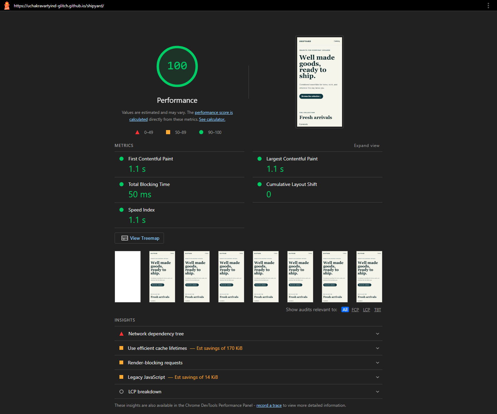

# ShipYard

A fast, responsive product catalog built with Next.js, TypeScript, optimized images and fonts, static product routes, and resilient loading, error, and not-found states.

## Live site

https://uchakravartyind-glitch.github.io/shipyard/

## Lighthouse

Mobile Performance: **100**

Measured with Lighthouse Mobile against the production GitHub Pages build. The report showed 1.1 s LCP, 0 CLS, and 50 ms Total Blocking Time. The remaining minor opportunities were cache lifetimes, render-blocking requests, and legacy JavaScript.



## Run locally

```bash
pnpm install
pnpm dev
```

Open http://localhost:3000/shipyard/.

To verify the optimized production export:

```bash
pnpm build
```

The static site is generated in `out/`.
